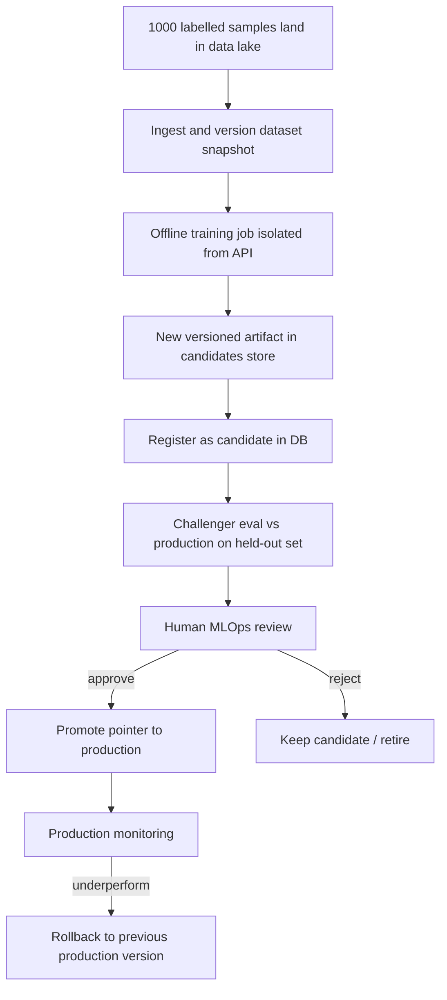

# Design: Updating the model after 1,000 new labelled samples

## Would the deployed model automatically retrain?

**No.** The production inference service is read-only with respect to model weights. Incoming labelled data is never applied to the live model. Automatic online retraining is explicitly out of scope for clinical-adjacent deployments: it removes human oversight, blurs audit trails, and can silently degrade safety-critical behaviour (e.g., recall on the positive class).

## Update process overview

## 1. Frozen production model

- Production traffic always reads a **fixed artifact** (SHA-256 recorded in `model_versions` and every inference log).
- The API process loads weights from disk; it does not expose training endpoints or mutate files in place.
- New data is stored separately (dataset snapshots, not mixed into the serving binary).

## 2. Separate offline retraining

- A batch job (CI pipeline or scheduled worker) consumes the new 1,000 samples plus historical training data according to a documented recipe.
- Training runs in an environment **without** production credentials or direct attachment to the live database used for inference logging.
- Output is a **new file** under `models/candidates/` (e.g., `v1.2.0`), never an overwrite of `v1.0.0` or the current production path.

## 3. Validation / challenger comparison

- Before any promotion, `scripts/evaluate_candidate.py` (or an equivalent pipeline step) scores:
  - the **candidate** model, and
  - the **current production** model
  on the same held-out labelled evaluation set (which must not include the 1,000 samples used purely for training, or must use nested cross-validation as documented).
- Metrics persisted on the candidate record include accuracy, precision, recall, F1, and confusion counts, plus a side-by-side comparison object.
- Promotion gates can require minimum recall (healthcare bias toward limiting false negatives) and non-inferiority on precision.

## 4. Explicit approval

- Only users with the **mlops** role may call `POST /api/v1/models/{version}/promote`.
- The API rejects promotion unless `offline_metrics.eval_completed` is true and a textual **reason** is supplied.
- Promotion writes a row to `promotion_events` (who, when, from_version, to_version, reason).

## 5. Versioned deployment

- Promotion updates **status** in PostgreSQL (`candidate` → `production`, previous production → `retired`); artifact files remain immutable.
- Inference logs always record `model_version`, `artifact_sha256`, `preprocessing_version`, and `scaler_sha256` so any prediction can be reproduced.

## 6. Rollback path

- If monitoring detects elevated error rate, latency, or undesirable prediction distribution drift, MLOps calls `POST /api/v1/models/rollback`.
- Rollback restores the last known-good production version from promotion history and logs a `rollback` event.
- No redeploy of code is required—only the active version pointer changes, then workers reload or resolve the new active version on the next request (current implementation resolves per request from DB).

## What happens to the 1,000 new labels operationally?

1. **Ingest** — Append to a versioned training corpus (e.g., `datasets/snapshots/2026-10-28/`).
2. **Train offline** — Produce `v1.2.0` candidate artifact.
3. **Register** — MLOps registers metadata via API or migration seed.
4. **Evaluate** — Run challenger script on held-out eval CSV.
5. **Review** — Clinical/MLOps stakeholders review metrics and error analysis (not automated).
6. **Promote or reject** — Explicit promote; production continues on old version until then.
7. **Monitor** — Use `/api/v1/monitoring/summary` and `/api/v1/metrics`; rollback if needed.

This design prioritizes traceability, human gates, and reversible deployments over the convenience of continuous automatic learning.
